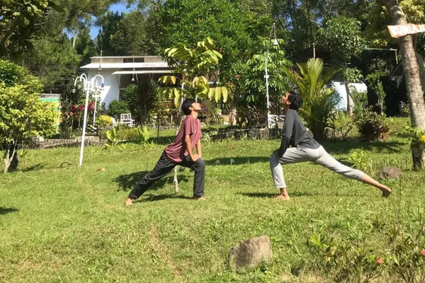

# 🪷 Shankara Well — Website

<p align="center">
  
</p>

**Live:** <https://shankarawell.yapsidarussalam.or.id> (HTTPS-only, 308 redirect dari HTTP)

Website resmi **Shankara Wellness & Sanctuary** — dibangun ulang dari
<https://shankarawell.com/> dengan arah: *lebih indah, lebih cepat, lebih
lengkap dari segala aspek*. Bilingual penuh **Indonesia / English**, fokus
performa (target GTmetrix A), dan siap deploy standalone di VPS.

---

## ✨ Fitur Utama

- **Bilingual ID/EN penuh** — switcher URL-param (`?lang=`) + localStorage via
  `useSyncExternalStore` (`src/components/shankara/language-context.tsx`),
  tanpa reload penuh, SEO-safe.
- **Konten lengkap** — Hero, Tentang, 4 layanan retreat, Program, Galeri,
  FAQ, CTA band, Kontak + Footer; seluruh copywriting dua bahasa terpusat di
  `src/lib/content.ts`.
- **WhatsApp deep-link** — tombol CTA & FAB langsung ke
  `wa.me/6287742765221` (umum) dan `62895337256877` (konsultasi layanan)
  dengan pesan ter-prefill per konteks.
- **Performa** — semua gambar pre-optimized (PIL → WebP/AVIF, hero AVIF ±56 KB,
  total ±0.9 MB/14 file), `images.unoptimized: true` agar aset terserve
  langsung dari `/images/*` dan ter-cache immutable 1 tahun di edge Cloudflare;
  Early-Hints `Link: preload` untuk LCP; halaman `/` = SSG murni.
- **SEO** — metadata lengkap, Open Graph, JSON-LD (`Organization` +
  `WebSite`), `robots.txt`.
- **HTTPS-only** — middleware Next.js redirect 308 `cf-visitor http → https`
  (loop-proof, lihat `src/middleware.ts`), di atas tunnel ZeroTrust yang
  memang sudah TLS-only.
- **Desain** — palet forest green `#0a1b13` + gold `#c4a265` + ivory
  `#fbfaf6`, font Marcellus (display) + Inter (body), animasi reveal CSS,
  dark scrollbar, mobile-first responsif (audit 12 viewport, tanpa overflow).

## 🧱 Tech Stack

| Layer | Pilihan |
|---|---|
| Framework | Next.js 16 (App Router, `output: "standalone"`) |
| UI | React 19, Tailwind CSS 4, shadcn/ui (hanya komponen terpakai) |
| Bahasa | TypeScript |
| Runtime | Bun (dev) / Node 20 (produksi, VPS) |
| Aset | WebP + AVIF hasil PIL, favicon + logo SVG |

## 📁 Struktur

```
├── src/
│   ├── app/                    # layout.tsx, page.tsx, globals.css, api/
│   ├── components/
│   │   ├── shankara/           # 12 komponen situs (navbar … footer)
│   │   └── ui/                 # shadcn/ui yang dipakai (accordion, toast, …)
│   ├── hooks/                   # use-mobile, use-toast
│   ├── lib/                     # content.ts (semua copy ID/EN), utils, db
│   └── middleware.ts            # enforce HTTPS (308 http→https)
├── public/
│   ├── images/                  # WebP/AVIF pre-optimized (immutable cache)
│   ├── logo.svg  favicon.ico  robots.txt
├── scripts/
│   ├── deploy-files/            # systemd unit, start.sh, PORT_MAPPING.md, UNIT.md
│   └── *.py                     # util gambar, QA, dan deploy VPS
├── UNIT.md  start.sh            # docs deploy di root (mirror layout VPS)
├── prisma/schema.prisma         # scaffold (situs ini murni statis)
└── next.config.ts               # standalone + header cache & Early Hints
```

## 🚀 Menjalankan Lokal

```bash
bun install
cp .env.example .env      # opsional; situs statis, tidak butuh DB
bun run dev               # http://localhost:3000
```

## 📦 Build Produksi (standalone)

```bash
bun run build   # next build + salin static & public ke .next/standalone
bun run start   # jalankan .next/standalone/server.js
```

## 🖥️ Deployment di VPS

Arsitektur: **Cloudflare ZeroTrust tunnel → proxy pusat HTTPS :3980 → app
Next.js standalone `127.0.0.1:4080`** (loopback only), direktori
`/var/www/shankarawell`, unit systemd `shankarawell`.

```bash
# di VPS
systemctl restart shankarawell
journalctl -u shankarawell -f
tail -f /var/www/shankarawell/standalone/next.log
```

Skema port VPS: **399x khusus project yapsi; 397x–398x project lain**
(internal = digit-match 40xx). Dokumen acuan: `/root/PORT_MAPPING.md` di VPS
(salinan di `scripts/deploy-files/PORT_MAPPING.md`).

## 🔧 Scripts Utilitas (`scripts/`)

| Script | Fungsi |
|---|---|
| `optimize_images*.py` | PIL → WebP/AVIF (kompresi + resize) untuk `public/images` |
| `make_favicon.py` | Generate favicon dari logo |
| `scan_white_edge.py` | QA responsif — audit overflow 12 viewport |
| `deploy_setup.py` | Generate/tes kunci deploy ed25519 |
| `ssh_check.py` | Tes koneksi SSH ke VPS |
| `vps_deploy.py`, `vps_redeploy.py`, `vps_postcheck.py`, … | Deploy & verifikasi ke `/var/www/shankarawell` via paramiko/SFTP |
| `vps_lcp_diag.py` | Diagnostik LCP/TTFB di VPS (Optimization env GTmetrix) |

## ⬆️ Repository & Push

Repo resmi: **<https://github.com/smahud/LandingPage_Shankara>** (private, branch `main`).

```bash
git pull --rebase origin main   # sebelum mulai kerja, agar sinkron
git push origin main            # remote origin sudah terpasang
```

Riwayat git sudah bersih (tanpa secret). Setelah push, deploy VPS tetap
langsung dari folder project ini via `scripts/vps_redeploy.py`.

## 🔒 Catatan Keamanan

- `.ssh/` (kunci deploy ed25519) dan `.env` **sengaja tidak di-track** —
  jangan pernah `git add -f` keduanya.
- Script VPS hanya menyimpan hostname/port (`host.zerotier.my.id:2226`);
  semua token Cloudflare di-redact saat recon.
- Sertifikat wildcard `*.yapsidarussalam.or.id` dikelola di VPS, bukan di repo.
